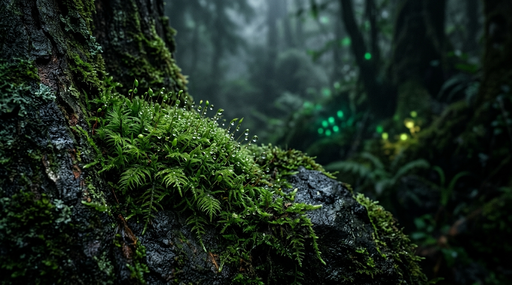
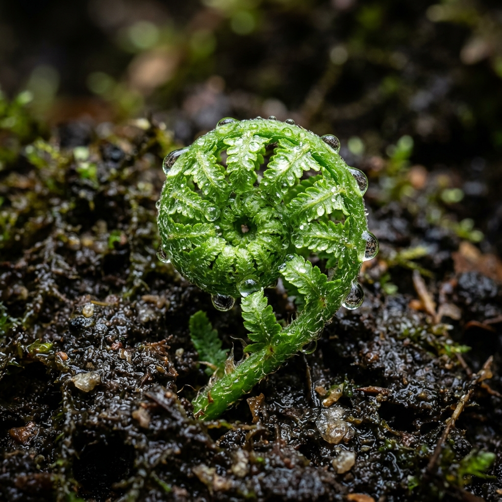
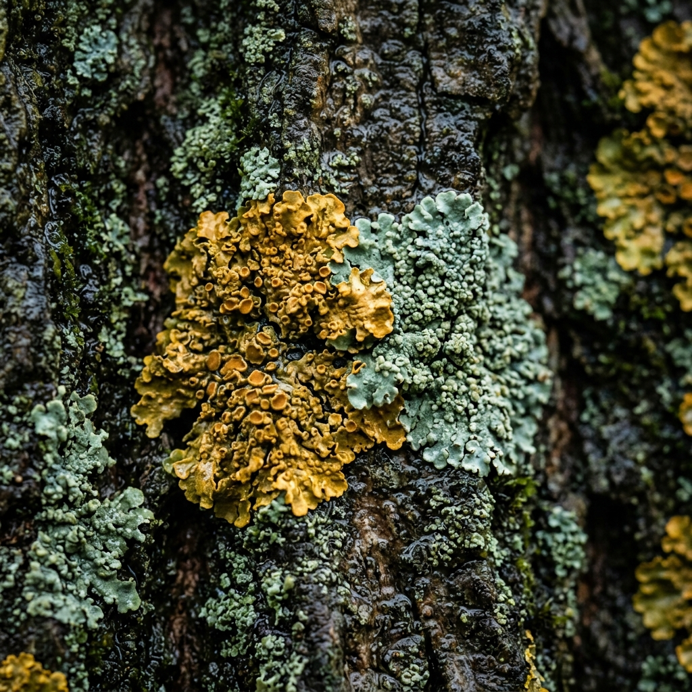
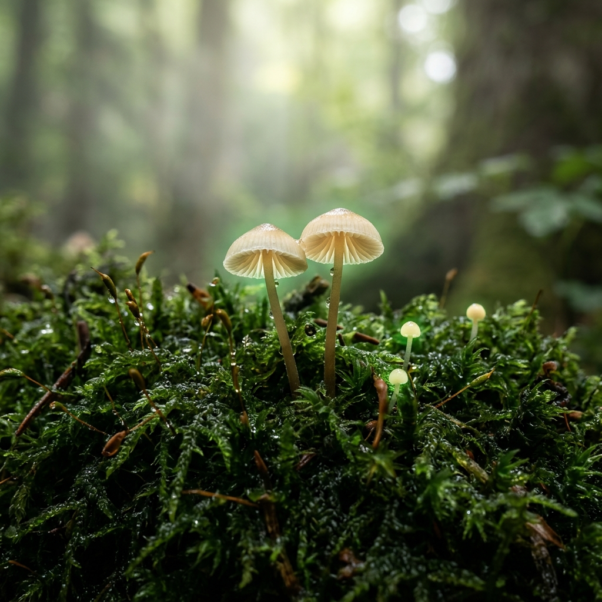

# 🌿 WildNotes

> **Observation that grows with you.**  
> *The offline, mindful outdoor naturalist companion designed to get you off the sterile screen and into physical contact with the living earth.*

<p align="center">
  
</p>

<p align="center">
  <a href="https://hacktoberfest.com"></a>
  <a href="https://fastapi.tiangolo.com"></a>
  <a href="https://ollama.com"></a>
  <a href="https://docker.com"></a>
</p>

---

## 🍃 Philosophy: The Touch Grass Protocol

Most nature apps reduce outdoor encounters to a sterile taxonomic Latin label on a phone screen. You snap a picture, glance at the name, and put the phone back in your pocket without ever truly looking at the organism.

**WildNotes changes that.**

Instead of encyclopedic lectures, WildNotes acts as an empathetic field guide:
1. **🔎 Look Closer**: Points your eyes toward repeating fractals, vein bifurcations, and hidden micro-patterns.
2. **✋ Touch & Feel**: Challenges you to physically touch the specimen — is it spongy, cool, velvety, brittle, or damp?
3. **👃 Scent & Surroundings**: Prompts you to breathe in the petrichor, wood tannins, and companion organisms.
4. **🧘 Mindful Pause**: Reminds you to take three slow breaths and ground yourself in the moment.

<p align="center">
  
  
  
</p>
<p align="center"><em>Real trail curiosities (Fern, Lichen, Mushrooms) processed by the on-device vision model, generating tactile micro-challenges.</em></p>

---

## ✨ Features

- **🌲 Pure Glassmorphic Biome Design**: High-contrast obsidian dark palette, glowing emerald and chartreuse accents, and fluid responsive cards inspired by modern organic aesthetics.
- **📷 Versatile Specimen Capture**: 
  - Drag-and-drop image upload
  - Live webcam / mobile camera viewfinder with HUD crosshair and snapshot trigger
  - Instant pre-loaded test curiosities (*Spiral Fiddlehead Fern* and *Golden Oak Lichen*)
- **⚡ 100% Offline & Private AI**: Powered by **Ollama (`moondream`)** directly on your computer — no tracking, zero cloud latency, and complete data sovereignty.
- **🔊 Procedural Forest Soundscape**: An interactive ambient audio generator synthesizing gentle forest breeze and birdsong via the Web Audio API without needing external audio files.
- **📓 Personal Trail Chronicle**: Automatically records discoveries into a local journal with one-click **Markdown Export** for field researchers and hikers.
- **🛡️ Zero-Crash Cloud Fallback**: Automatically adapts if deployed in environments without local Ollama, ensuring 100% uptime and demo readiness.

---

## 🎃 Hacktoberfest 2026

WildNotes is proudly participating in **Hacktoberfest 2026**! 🎉

We welcome contributions from developers, outdoor enthusiasts, and designers of all experience levels:
- 🌿 **Sensory Prompt Engineering**: Enhance tactile observation challenges and mindful field questions.
- 📸 **Specimen Assets**: Submit high-resolution macro photography of mosses, fungi, lichens, and plants.
- 🔊 **Audio Biomes**: Add new procedural soundscapes (coastal rain, high mountain wind, stream babble).
- 📱 **Mobile & PWA**: Help refine the touch experience for offline field expeditions.

---

## 🚀 Quick Start (Local)

### 1. Prerequisites
- Python 3.10+
- [Ollama](https://ollama.com) installed and running

### 2. Pull the Vision Model
```bash
ollama pull moondream
```

### 3. Install Dependencies & Run
```bash
# Clone repository
git clone https://github.com/your-username/WildNotes.git
cd WildNotes

# Install Python requirements
pip install -r requirements.txt

# Start the application
python app.py
```

Open your browser at **`http://127.0.0.1:7860`**.

---

## 🚢 Production Deployment

WildNotes is container-ready and follows the twelve-factor methodology with environment-based configuration.

### Option 1: Docker (Recommended)
```bash
# Build the container
docker build -t wildnotes .

# Run container on port 7860
docker run -p 7860:7860 -e PORT=7860 wildnotes
```

### Option 2: Render
1. Create a new **Web Service** on [Render](https://render.com).
2. Connect your Git repository.
3. Render will automatically detect `render.yaml` or you can configure:
   - **Build Command**: `pip install -r requirements.txt`
   - **Start Command**: `python app.py`

### Option 3: Railway / Heroku
WildNotes includes a `Procfile` ready for automatic platform detection:
```bash
web: python app.py
```

### Option 4: Hugging Face Spaces
1. Create a new Space on Hugging Face.
2. Select **Docker** or **Blank SDK**.
3. Upload the repository. WildNotes automatically binds to `$PORT` (default `7860`).

---

## ⚙️ Environment Variables

Copy `.env.example` to `.env`:

| Variable | Default | Description |
| :--- | :--- | :--- |
| `PORT` | `7860` | Server listening port (auto-injected on Render/Railway/HF) |
| `HOST` | `0.0.0.0` | Server binding host |
| `OLLAMA_BASE_URL` | `http://localhost:11434` | URL to your Ollama instance |
| `OPENAI_API_KEY` | *(Optional)* | Cloud fallback vision key if Ollama is not local |
| `OPENAI_BASE_URL` | `https://api.openai.com/v1` | Custom endpoint for OpenAI-compatible cloud vision |

---

## 📂 Project Architecture

```
WildNotes/
├── app.py                  # Production FastAPI server & vision orchestration
├── requirements.txt        # Locked Python dependencies
├── Dockerfile              # Production container blueprint
├── Procfile                # Platform as a Service start definition
├── render.yaml             # Render infrastructure-as-code blueprint
├── .env.example            # Environment template
├── nature_journal.json     # Local persistent trail log
└── static/
    ├── index.html          # Semantic HTML5 with PWA & OpenGraph metadata
    ├── css/
    │   └── style.css       # Verdant dark glassmorphism design system
    ├── js/
    │   └── app.js          # Client engine, camera, soundscape & sensory checklist
    └── images/
        ├── verdant_bg.jpg  # Macro forest moss background
        ├── sample_fern.jpg # Instant specimen: Spiral Fiddlehead
        └── sample_lichen.jpg # Instant specimen: Golden Oak Lichen
```

---

## 📜 License

Created with care for outdoor enthusiasts. MIT License.
